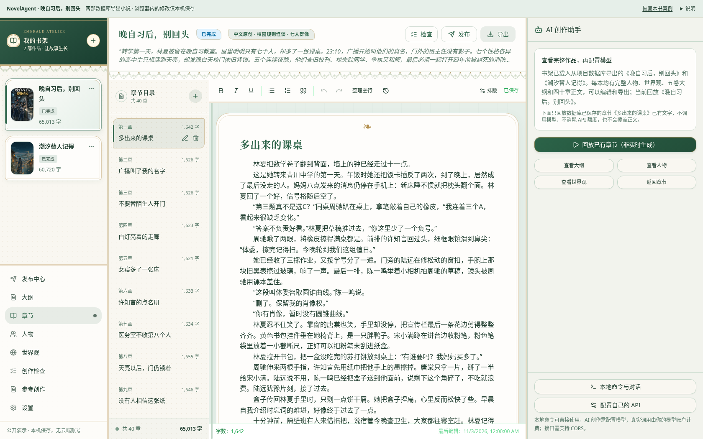

# NovelAgent · AI 小说创作工作台

把灵感、设定、正文和修改放在同一个写作空间里。NovelAgent 是一个面向中文长篇创作的 Web 应用，提供章节编辑、AI 辅助创作、人物关系画布、全书检查、参考作品分析和稿件导出。

**[体验在线演示](https://liqingqing001.github.io/noval-agent/)** · [本地运行](#本地运行完整版) · [功能说明](#可以做什么) · [文档导航](#文档导航)



## 可以做什么

| 创作环节 | 已有能力 |
| --- | --- |
| 组织作品 | 多本小说书架、封面预览、章节管理、世界观分类、卷与章节大纲、伏笔管理与大纲进度 |
| 编辑与导出 | 富文本正文、撤销重做、段落排版偏好、空行整理；按当前章或整本导出 TXT、Markdown、DOCX |
| AI 辅助创作 | 续写、润色、重写、设定与大纲生成；发送前查看上下文，优先使用当前或明确指定章节；斜杠命令搜索、中文别名和参数补全 |
| 对话体验 | 按作品保存输入草稿、生成时准备下一条需求、复制回复、历史压缩；失败或停止后保留已收到内容，支持手动重试 |
| 人物与关系 | 人物档案、头像与状态、关系画布；全景 / 单人 / 两人视图，人物与关系线独立拖动、连线编辑及档案返回 |
| 创作检查 | 章节版本保存、比较与恢复；本地结构检查、按需调用模型做全书一致性检查、人物状态时间线；AI 结果先审阅再使用 |
| 参考创作 | 粘贴或导入 TXT / Markdown，最多 100 万字符；选范围、分批分析与汇总，再换主题拟提纲并确认生成新稿 |
| 调用与预算 | 记录模型、耗时、输出字符、token 来源和费用估算；设置单价、每月 / 单次预算，提醒或发送前拦截 |
| 投稿准备 | 十四个平台 / 渠道的投稿路径与 AI 政策说明；复制章节、导出稿件与投稿资料，生成独立 HTML 阅读页 |
| 手机与快捷操作 | 手机阅读与书架布局、人物画布双指缩放 / 平移；书籍、人物、章节支持右键与 Shift+F10 |

<details>
<summary>查看人物关系画布</summary>


</details>

## 先体验在线演示

打开 **[GitHub Pages 演示](https://liqingqing001.github.io/noval-agent/)**，无需注册即可浏览两部完整示例作品，进入章节、大纲、人物、世界观和创作工具。

| 示例作品 | 类型 | 规模 |
| --- | --- | --- |
| 《晚自习后，别回头》 | 校园规则怪谈、七名高中生群像 | 40 章，65,013 汉字；默认打开 |
| 《潮汐替人记得》 | 海洋幻想、社会悬疑 | 40 章，60,720 汉字 |

两部示例包含正文、封面、人物资料与 AI 生成头像、世界观、五卷细纲和伏笔。示例先写入项目 SQLite，再查询业务表生成 Pages 使用的快照。

- **浏览与编辑**：访问者的修改保存在自己的浏览器，不写回仓库，也不上传到示例数据库。自动更新会保留已有改稿与自建作品。
- **回放与真实生成**：「回放已有章节」展示保存的文字，明确标注为非实时生成；真实 AI 创作需要在设置中配置自己的模型 API，并按所用服务计费。
- **普通应用与演示版**：共用创作组件和解析逻辑；Pages 是静态站点，不运行 Node 后端或 SQLite 服务，主要区别在账号、存储和示例初始化方式。

## 模型接入与功能边界

支持 **OpenAI Chat Completions、OpenAI Responses、Anthropic Messages、Gemini** 协议，并提供 DeepSeek、通义千问、智谱、Moonshot、硅基流动、Ollama、LM Studio 等连接预设及自定义地址。实际可用性取决于所选服务对协议、模型、认证和浏览器跨域请求的支持；本地模型也需要先启动相应服务。

在「设置」中配置服务地址、模型和必要的 API Key，再使用连接测试。模型配置与部分创作辅助记录保存在当前浏览器；不要在共享设备上保留个人密钥，也不要把 `.env` 或 API Key 提交到 GitHub。

费用面板会区分服务端报告与本地估算的 token，费用是按自定义单价计算的参考值，不能代替服务商账单。预算拦截属于本地发送前检查。

「发布中心」用于投稿准备、资料导出和跳转官方后台。**当前没有接入远端自动上传、审核或签约**；下载稿件或独立阅读页不等于已经在平台发布。具体政策、来源和限制见 [平台调研](docs/research/publishing-platforms.md)。

## 本地运行完整版

### 环境与技术栈

建议使用 **Node.js 24 LTS + npm**。项目使用 npm workspaces，命令在仓库根目录执行；以下示例适用于 PowerShell。

| 部分 | 技术 |
| --- | --- |
| 前端 | React 19、TypeScript、Vite 8、Tailwind CSS、Radix UI、Zustand、Tiptap |
| 后端 | Node.js、Express、TypeScript、JWT、bcrypt |
| 数据 | SQLite、Prisma；浏览器侧 localStorage / IndexedDB 保存部分本机资料 |
| 验证与交付 | Node 测试、Playwright 浏览器检查、GitHub Actions / Pages |

### 1. 安装与首次配置

```powershell
git clone https://github.com/Liqingqing001/noval-agent.git
Set-Location noval-agent
npm ci
Copy-Item packages/backend/.env.example packages/backend/.env
```

首次创建 `packages/backend/.env` 后，将 `JWT_SECRET` 替换为自己的长随机字符串。已有 `.env` 时保留原文件，不要再次覆盖。默认配置如下：

| 配置 | 用途 |
| --- | --- |
| `DATABASE_URL="file:./dev.db"` | SQLite 文件，默认位于 `packages/backend/prisma/dev.db` |
| `PORT=3001` | 后端开发端口 |
| `JWT_SECRET` | 后端登录令牌签名密钥 |
| `NODE_ENV=development` | 本地开发环境 |

前端 API 默认请求 `http://localhost:3001/api`。若修改后端地址，可在 `packages/frontend/.env.local` 中设置 `VITE_API_URL`；前端环境变量会进入浏览器代码，不要在其中放后端密钥。

### 2. 初始化数据库并启动

```powershell
npm run db:generate
npm exec --workspace=backend -- prisma migrate deploy
npm run dev
```

- 前端：`http://localhost:5173`
- 后端健康检查：`http://localhost:3001/api/health`
- 本地完整版需要注册自己的账号；Pages 演示不需要登录。

开发时新增数据库结构使用 `npm run db:migrate`，查看数据可运行 `npm run db:studio`。已有数据时先备份；`db:reset` 会清空数据库，不是日常启动步骤。

<details>
<summary>可选：导入双书示例到本地完整版</summary>

先完成上述数据库初始化，再在仓库根目录执行：

```powershell
npm run demo:import
npm run demo:check
```

请先在本地完整版注册账号。库中只有一个用户时会导入该账号；多个用户时需要用 `--owner-id` 明确指定归属。空库会创建不可登录的示例所有者，因此不适合直接拿来作为登录账号。导入会更新固定示例 ID 的内容并重新导出公开快照，已有示例改稿请先备份。详情见 [导入脚本](scripts/import-demo-library.mjs) 与 [入库说明](docs/updates/2026-11-03-database-backed-case.md)。只想体验功能时直接访问在线演示即可。

</details>

### 3. 构建与检查

```powershell
npm run build                  # 构建前后端
npm run test:sync              # 结构化内容与修改指令同步
npm run test:models            # 模型协议与请求处理
npm run test:editor            # 编辑与导出
npm run test:board             # 人物画布逻辑
npm run test:review            # 版本、一致性与时间线
npm run test:chat              # 对话上下文、草稿与复制
npm run test:slash             # 斜杠命令
npm run test:usage             # 调用记录与预算
```

更多专项与浏览器检查见 [package.json](package.json) 和 [Pages 工作流](.github/workflows/pages.yml)。浏览器检查需要 Playwright / Chromium，并按具体测试脚本准备构建和运行模式；这里列出的命令不是一次全量测试已通过的声明。

## 数据如何保存

| 数据 | 本地完整版 | Pages 演示 |
| --- | --- | --- |
| 账号、小说、章节、人物资料、世界观、大纲、伏笔 | 通过后端 API 写入 SQLite，前端也有本机缓存 / 状态 | 示例快照初始化，后续修改仅在当前浏览器保存 |
| 画布布局、手动关系线调整、排版偏好等 | 当前浏览器 | 当前浏览器 |
| 版本历史、创作检查、参考创作进度、调用预算等辅助资料 | 按各模块设计存于当前浏览器 | 当前浏览器 |
| 模型连接配置 | 当前浏览器 | 当前浏览器 |

清理浏览器数据、换浏览器或换设备可能导致本机资料无法继续使用；并非所有辅助资料都经过后端同步。重要稿件请主动导出备份。人物关系与状态的具体保存范围见 [人物画布说明](docs/prd/character-board-v1.md) 与 [创作检查说明](docs/updates/2026-11-04-writing-review.md)。

## 项目结构

```text
noval-agent/
├─ packages/frontend/        # 创作界面、演示模式、编辑与导出、浏览器测试
├─ packages/backend/         # Express API、Prisma schema 与迁移
├─ scripts/                  # 示例作品构建、数据库导入与快照导出
├─ docs/prd/                 # 功能需求与设计说明
├─ docs/updates/             # 专项更新记录、操作方式与边界
├─ docs/database-design/     # 独立的数据库课程设计材料
└─ .github/workflows/        # 构建、检查与 Pages 部署
```

## 文档导航

| 想了解什么 | 文档 |
| --- | --- |
| 演示模式与发布方式 | [Pages 演示说明](docs/updates/2026-11-01-github-pages-demo.md) |
| 示例作品与数据库快照 | [双书案例](docs/updates/2026-11-03-school-ensemble.md) · [入库说明](docs/updates/2026-11-03-database-backed-case.md) |
| 正文排版和多格式导出 | [编辑与导出](docs/prd/editor-export-v1.0/README.md) |
| 人物关系、聚焦和手机操作 | [人物画布](docs/prd/character-board-v1.md) · [关系线与档案浏览](docs/updates/2026-11-04-character-relationships.md) · [手机手势](docs/updates/2026-11-03-mobile-character-board.md) |
| AI 对话与斜杠命令 | [对话体验](docs/updates/2026-11-04-chat-experience.md) · [命令说明](docs/updates/2026-11-04-slash-commands.md) |
| 版本、一致性和人物时间线 | [创作检查](docs/updates/2026-11-04-writing-review.md) |
| 参考作品的分批分析与新稿 | [长文参考创作](docs/prd/reference-longform-v2.md) |
| token、费用和预算 | [调用与预算](docs/updates/2026-11-04-usage-budget.md) |
| 投稿平台与能力边界 | [发布中心](docs/updates/2026-11-03-publishing-hub.md) · [平台政策](docs/research/publishing-platforms.md) |
| 项目架构与开发约定 | [架构说明](ARCHITECTURE.md) · [协作约定](AGENTS.md) |
| 数据库课程设计 | [独立数据库设计材料](docs/database-design/README.md) |
| 四表课程简化版与答辩材料 | [work 分支的期末作业目录](https://github.com/Liqingqing001/noval-agent/tree/work/docs/course-final)，独立教学程序，不代替本项目完整版 |

后续维护记录按专题保存在 `docs/updates/`；README 作为项目入口，优先说明当前能力、运行方式与数据边界。
